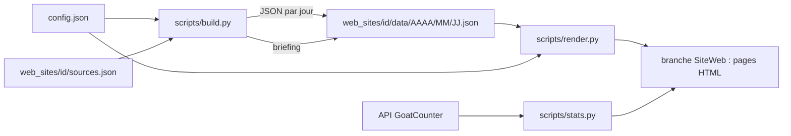

# Industry Watch

Portail de veille automatisée : des **sites thématiques** (marchés) et des **sites comptes** (une entreprise),
alimentés toutes les 2 heures par des flux RSS, résumés par IA et publiés en pages statiques.

Publié sur : <https://ibmphilippecabel.github.io/industry-watch/>

## Sites actuels

| Id | Nom | Section | Type |
|---|---|---|---|
| `petfood-watch` | Petfood | Industries & Markets | marché |
| `beverage-watch` | Drinks & Spirits | Industries & Markets | marché |
| `beauty-watch` | Beauty & Cosmetics | Industries & Markets | marché |
| `mars` | Mars Corporation | Companies & Accounts | compte |
| `pernod-ricard` | Pernod Ricard | Companies & Accounts | compte |
| `loreal` | L'Oréal | Companies & Accounts | compte |

Un **site marché** collecte les flux de la presse spécialisée du secteur. Un **site compte** ajoute un filtre :
seuls les articles qui mentionnent l'entreprise (ses divisions et marques) sont conservés.

## Architecture



| Dossier / fichier | Rôle |
|---|---|
| `config.json` | **unique source de configuration** : portail, liste des sites, marques, filtres. |
| `web_sites/<dossier>/sources.json` | flux RSS du site. |
| `web_sites/<dossier>/data/` | articles (`AAAA/MM/JJ.json`) et briefings (`JJ.briefing.txt`). Versionnés sur `main`. |
| `web_sites/<dossier>/` | icône du site. |
| `scripts/` | `build.py`, `render.py`, `stats.py`, `common.py`. Documentation de chacun dans [`scripts/.doc/`](scripts/.doc/). |
| `.github/workflows/OnSchedule_Site_Update.yml` | automatisation. |

Le HTML généré **n'est pas** sur `main` : il est publié sur la branche `SiteWeb` (valeur `site_branch`).

## `config.json`

Clés globales : `site_branch`, `site_root_url`, `portal_name`, `portal_description`, `portal_icon`, `goatcounter_url`, `sites`.

Clés d'un site (dans `sites[]`) :

| Clé | Obligatoire | Rôle |
|---|---|---|
| `id` | oui | identifiant, utilisé dans l'URL (`.../industry-watch/<id>/`) et par `--site <id>`. |
| `section` | non | titre du groupe sur le portail (« Industries & Markets », « Companies & Accounts »). |
| `status` | non | `live` (défaut) ou `under_construction` (page d'attente 🚧). |
| `industry` | non | pour un site compte : id (ou liste d'ids) du ou des sites marché auxquels il appartient. Affiche « Industry : … » sur le compte, « Accounts : … » sur le site marché, et sur les cartes du portail. Un id inconnu est ignoré sans erreur. |
| `site_name`, `site_description` | oui | affichés sur le site, **et injectés dans les prompts IA** (résumés et briefing). |
| `site_icon` | non | `{"default": "emoji", "path": "fichier local", "url": "icône distante"}`. Ordre : fichier local, puis URL, puis emoji. Préférer un **SVG** : un `.ico` 16×16 est flou une fois agrandi. |
| `rolling_days` | non | fenêtre de la page d'accueil (30 par défaut) ; les archives gardent tout. |
| `sources_file`, `data_dir` | oui | chemins vers `sources.json` et le dossier `data`. |
| `categories` | non | liste des **boutons de thème** et des clés du briefing. Par défaut : les `default_category` distincts de `sources.json`. |
| `brands` | non | liste de marques/entreprises : génère le **filtre « Brands »** (surtout pour les sites marché). |
| `account_filters` | non | pour les sites compte : `divisions`, `owned_brands`, `in_acquisition`. Active le filtre de pertinence à la collecte et alimente le filtre « Brands ». |

À savoir sur les marques :
- Comparaison **insensible à la casse, aux accents et aux apostrophes** (`L’Oréal` = `L'Oreal`) et en **mot entier**.
- Les variantes sans espace ou avec tiret sont des mots différents : `loreal` et `l'oreal` sont à lister séparément.
- Le filtre « Brands » n'apparaît que si **2 marques au moins** sont trouvées dans les articles affichés.

Exemple minimal d'un site marché :
```json
{
  "id": "beauty-watch",
  "section": "Industries & Markets",
  "status": "live",
  "site_name": "Beauty & Cosmetics",
  "site_description": "Daily AI-assisted intelligence on the global beauty and cosmetics market.",
  "site_icon": { "default": "💄", "path": "web_sites/beauty_watch/icon.svg" },
  "brands": ["L'Oréal", "Estée Lauder", "LVMH", "Coty"],
  "rolling_days": 30,
  "sources_file": "web_sites/beauty_watch/sources.json",
  "data_dir": "web_sites/beauty_watch/data"
}
```

## `sources.json`
Liste d'objets :
```json
{
  "name": "Cosmetics Business",
  "url": "https://www.cosmeticsbusiness.com/",
  "rss": "https://www.cosmeticsbusiness.com/rss",
  "description": "International B2B reference on cosmetics and beauty brands.",
  "score": "9.0",
  "default_category": "📈 Market"
}
```
- `rss: null` : source listée dans le menu « Sources » mais non collectée.
- `default_category` : catégorie quand aucun mot-clé (M&A, Regulation, Innovation) ne s'applique. **Chaque valeur distincte devient un bouton de thème** (sauf si `categories` est défini).
- Les requêtes **Google News** (`news.google.com/rss/search?q=...`) sont pratiques mais larges ; pour un site compte, le filtre de pertinence les contrôle aussi, mais il vaut mieux restreindre la requête elle-même.

## Ajouter un site

1. Créer `web_sites/<dossier>/` avec un `sources.json` (et une icône SVG).
2. Ajouter le bloc du site dans `config.json` (`sites[]`), avec un `id` unique.
3. Tester en local :
   ```powershell
   python scripts/build.py --site <id>
   python scripts/render.py --site <id> .tmp_out
   ```
   puis ouvrir `.tmp_out/index.html`.
4. Commiter et pousser sur `main`. **Aucune modification du workflow** : il lit la liste des sites dans `config.json`.

Pour un site compte, renseigner `account_filters` ; pour un site marché, renseigner `brands` si on veut le filtre par marque.

## Workflow GitHub (`OnSchedule_Site_Update.yml`)

Déclencheurs : toutes les 2 heures (`cron: 0 */2 * * *`) et manuellement (*workflow_dispatch*).

1. **setup** — lit `config.json` et prépare la liste des `id` et le nom de la branche de publication.
2. **fetch** — un job par site, en parallèle : `python scripts/build.py --site <id>`, puis commit des nouveaux fichiers sous `web_sites/` sur `main`.
3. **render** — rend tous les sites avec `render.py`, génère les stats avec `stats.py`, puis pousse le résultat sur la branche `SiteWeb`.

Les échecs de `build.py` ne font pas échouer le job (`|| true`) : consulter les logs et le résumé du job.

## Secrets et variables

À définir dans *Settings → Secrets and variables → Actions* :

| Nom | Usage | Si absent |
|---|---|---|
| `GROQ_API_KEY` | résumés et briefing IA (modèle `openai/gpt-oss-20b`, offre gratuite) | les articles sont stockés sans résumé ni briefing. |
| `GOATCOUNTER_API_KEY` | lecture des statistiques de visites | pages de stats « No data yet ». |

`GITHUB_TOKEN` est fourni automatiquement. Le compteur de visites est celui indiqué par `goatcounter_url`.

## Utilisation locale

Prérequis : Python 3.10 ou plus, **aucune dépendance externe** (bibliothèque standard uniquement).

```powershell
python scripts/build.py --site loreal              # collecte (sans IA si GROQ_API_KEY absent)
python scripts/render.py --site loreal .tmp_out    # rendu d'un site
python scripts/stats.py .tmp_out                   # pages de stats (pending sans clé)
```
Sous Windows, si la console affiche des erreurs d'encodage : `$env:PYTHONIOENCODING='utf-8'`.

## Dépannage rapide

| Symptôme | Piste |
|---|---|
| Un site est vide | `build.py` n'a trouvé aucun article : vérifier les flux (`WARN` dans le log) ; le site affiche alors une page d'attente. |
| Articles hors sujet sur un site compte | durcir la requête Google News dans `sources.json`, ou ajouter des mots-clés précis dans `account_filters`. |
| Une marque ne s'affiche pas dans le filtre | elle n'est pas trouvée dans titre + extrait ; vérifier l'orthographe exacte dans `brands`/`owned_brands`. |
| Icône floue | remplacer le `.ico` par un SVG et mettre à jour `site_icon.path`. |
| Pas de briefing | `GROQ_API_KEY` absent, ou réponse IA rejetée (voir `WARN briefing` dans le log). |

## Avertissement
Toutes les sources sont publiques. Contenu assisté par IA, compilé pour un usage interne de conseil. Publication
indépendante : elle ne représente pas les positions officielles des entreprises citées.
